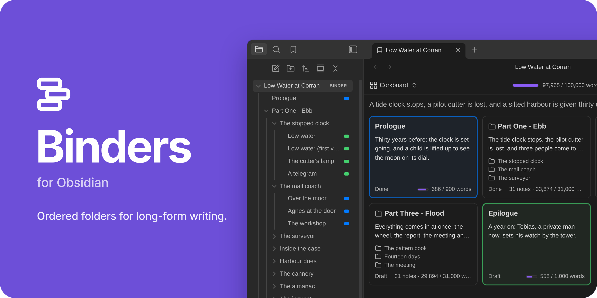
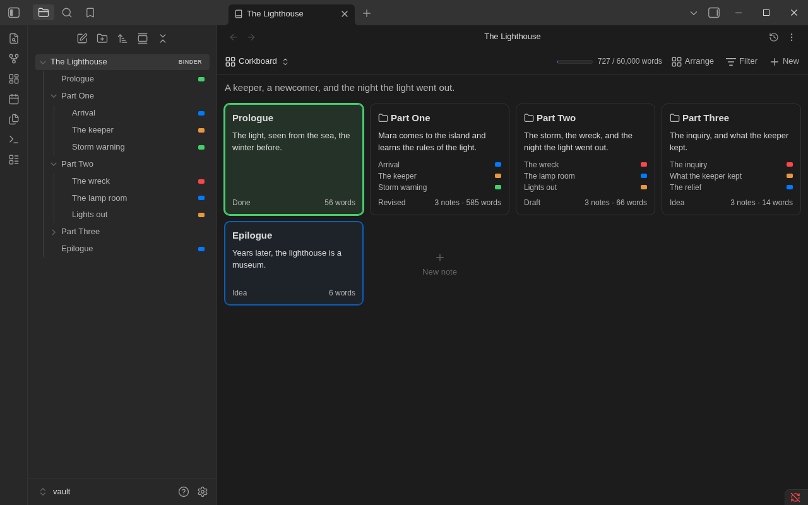
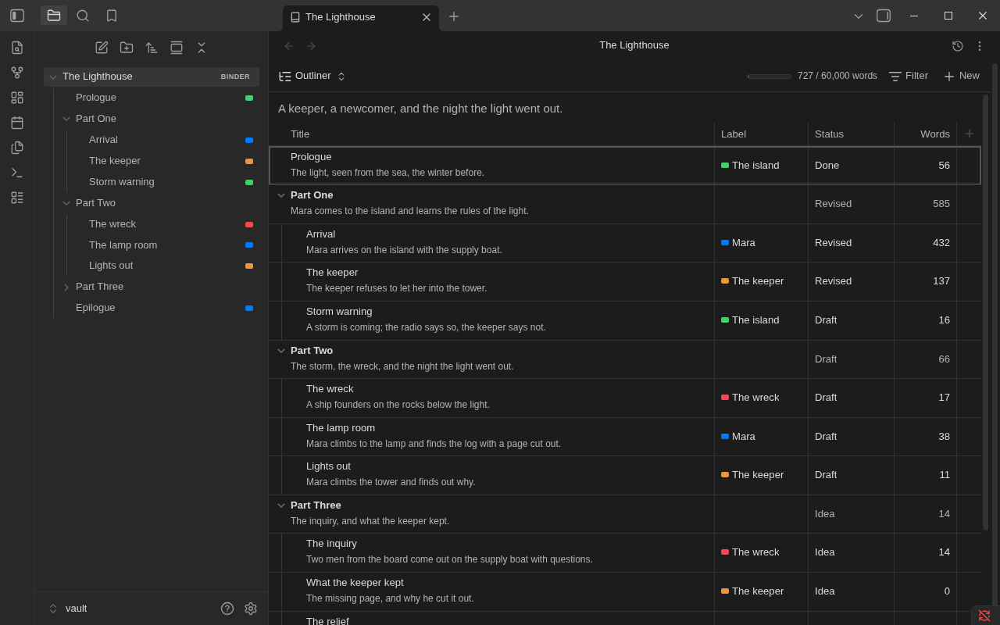
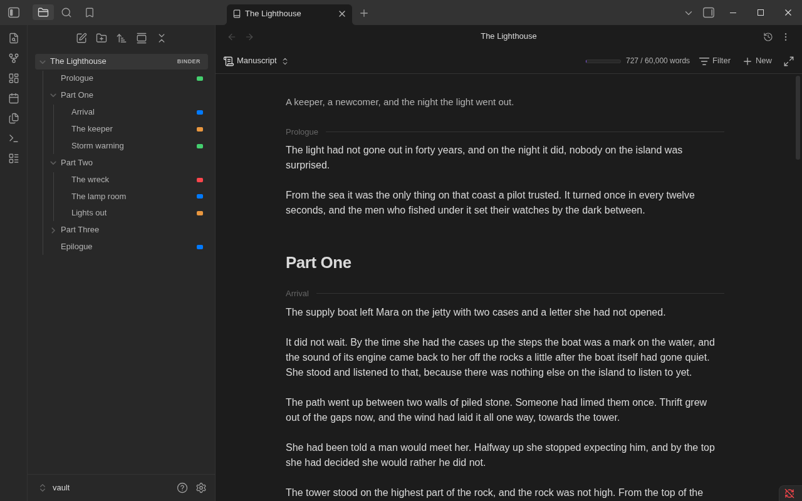
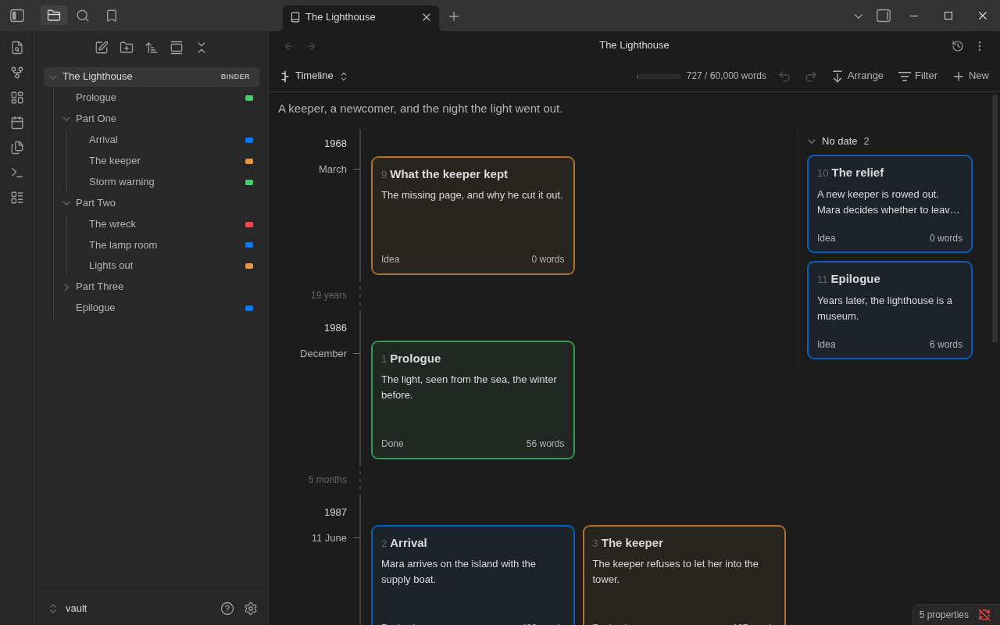

<h1 align="center">Binders for Obsidian</h1>

<p align="center"></p>

<p align="center">A binder in the file explorer · a corkboard · an outliner · an editable manuscript · a story timeline</p>

Folders in Obsidian list their notes by name. Books don't work that way. Binders turns a folder into a **binder**: its
chapters and scenes keep the order you give them, in Obsidian's own file explorer. Open a binder to see the same notes
as a corkboard, an outliner, one continuous manuscript you can edit, or a timeline of the story.

Everything stays plain Markdown. A binder is a folder plus one note that holds its order, and everything about a scene
is in that scene's own properties. Turn Binders off and your notes are still ordinary notes.

> **Public beta.** Binders is in public beta. Phone and tablet support is new and has had little testing on real
> devices. Report what you find in the [issue tracker](https://github.com/fyresmith/binders/issues).

This README and the [manual](docs/README.md) follow the code on `main`, including features not yet released.
The [Unreleased entries](CHANGELOG.md#unreleased) say what is coming in the next release. Installing through
Obsidian, BRAT or a release download gives you the published plugin; its documentation is in that release's tag.

## What it does

- **Order.** Notes and folders keep the order you give them, in the file explorer and everywhere else.
- **Four views of one binder.** A corkboard of index cards, an outliner with columns you pick, the whole
  manuscript as one page you can edit, and a timeline of its scenes by story date.
- **Scrivener-style tools.** Labels, statuses and word count targets; an inspector; split, merge, duplicate and
  group scenes; snapshots of a scene, a folder or the whole binder, so you can rewrite without losing the old text;
  undo and redo of moves, properties, renames, new notes, deletes, merges and splits.
- **Export.** A submission manuscript in standard manuscript format (Word or PDF), an ebook (EPUB) for Kindle,
  Apple Books and Kobo, a print-ready paperback PDF, the binder itself as a Scrivener project, or the whole binder
  as one note. Book styles you can change, with the real pages beside them.
- **Import from Scrivener.** A Scrivener 3 project, or a zipped backup of one, as a new binder: you see it before it is made.
- **Import a manuscript.** A Word file, a Markdown note or a text file as a new binder, split at its chapters,
  with a preview you can put right before anything is made. The source stays as it is.
- **Find and replace.** Search every note of a binder; replace one match (taken back with Undo in the editor), or replace all after a review and a snapshot, with Undo.
- **Focus mode.** The text and nothing else, with typewriter scrolling.
- **Longform.** Longform projects open as binders, and convert to them.
- **Phones and tablets.** The same views, by touch, on iOS and Android.

The [manual](docs/README.md) covers all of it.

## Installation

Binders needs Obsidian 1.13.4 or later, on a computer, a phone or a tablet.

- **From Obsidian:** open **Settings → Community plugins → Browse**, search for **Binders**, then **Install** and
  **Enable**. Binders is in Obsidian's [community plugin directory](https://community.obsidian.md/plugins/binders).
- **With BRAT**, to try versions as they come out: install **BRAT** from **Settings → Community plugins → Browse**, run its command **Plugins: Add a
  beta plugin for testing**, give it `fyresmith/binders` and choose the newest version. BRAT installs Binders and
  can keep it up to date.
- **By hand:** download `main.js`, `manifest.json` and `styles.css` from the newest
  [release](https://github.com/fyresmith/binders/releases), put them in
  `<your vault>/.obsidian/plugins/binders/`, and enable **Binders** under **Settings → Community plugins**.
- **From source:** `npm install`, then `npm run build`; see [Development](docs/dev/development.md).

More in [Installation](docs/installation.md).

## Getting started

1. **Make a folder a binder.** Right-click a folder in the file explorer and choose **Make this folder a binder**.
   Its notes and subfolders keep the order they show in now.
2. **Arrange its scenes.** Click the folder. The binder view opens on it as a corkboard. Drag the cards into the
   order you want.
3. **Switch to Manuscript and write.** Click **Corkboard** at the top left of the view and choose **Manuscript**.
   The whole binder is one page, and each section is the note itself.

The [walkthrough](docs/getting-started.md) goes on from here to a first exported file.

## Four views

### Corkboard

One index card per note, with its title, synopsis, status, label color and word count. Drag cards to reorder them,
or lay them out by label to see how a book's threads take turns. [More](docs/corkboard.md)



### Outliner

The same notes as rows of a table, folders with their notes under them, with columns you pick: label, status,
words, target, progress, or any property of your notes. [More](docs/outliner.md)



### Manuscript

Every note in order as one page. Each section is a real Obsidian editor on that note, so typing, undo, links and
formatting work as they do in the note itself. [More](docs/manuscript.md)



### Timeline

Scenes along story time, each at its story date and numbered as the manuscript has it. Long empty stretches are
drawn short, and scenes with no date wait in a tray. Time runs down, or across on a computer or tablet. Set dates
from the menu, outliner or inspector; dragging to set a date is not built yet. [More](docs/timeline.md)



## Import a manuscript

Run **Import a manuscript...** to bring in a `.docx`, Markdown or text file. Chapters and scene breaks become notes
and folders, shown before they are made. Join, rename or split them in the preview. A note outside a binder has
**Make a binder from this note...** in its file explorer menu. [More](docs/import-manuscript.md)

## Find and replace

Press Ctrl+F in a binder view to search every note of the binder, in binder order: in the manuscript as one page, on the
corkboard and timeline, and in the outliner, by lighting the cards and rows that match. A link's target and a tag are not touched
unless you type them, and **Replace all** shows every change in context first, takes a snapshot, and can be undone; **Replace** changes one match, and the editor's Undo takes it back.
[More](docs/find-and-replace.md)

## Import from Scrivener

Run **Import from Scrivener...** from the command palette and choose a project, or a zipped backup of one. The
dialog shows the binder as it will be, and any note of it as it will read, before anything is made. The order,
synopses, notes, labels, statuses, targets and snapshots come across; Research can be left behind. The project
itself is never changed, and every original file is kept beside the notes.
[More](docs/import-scrivener.md)

## Your files

A binder is a folder with a binder note, named like the folder, whose `contents` property is the order:

```yaml
---
binder: 1
contents:
  - Prologue
  - Part One/
  - Part One/Arrival
  - Epilogue
---
```

Each scene is an ordinary note, and what its card shows (`synopsis`, `status`, `label`, `target`) are its
properties. Binders writes its own properties and the ones you edit through its views. Text changes where you
type or ask for a split, merge, rewrite, snapshot restore or replacement. A whole snapshot restore can also put
properties, names and locations back, after review. Links on tab-led paragraphs follow an Obsidian-approved rename.
[How your files look](docs/files.md) has the whole account.

## Limitations

- **Public beta.** The maintainer uses an iPhone; iPad and Android coverage is still through desktop emulation.
  [What hasn't been tried](docs/limitations.md#not-yet-tried) is listed in full.
- **Other file explorers.** Plugins that replace the file explorer, such as Notebook Navigator, don't show binder
  order. The binder view works either way.
- **Obsidian internals.** Binder order in the file explorer and the editable manuscript rely on parts of Obsidian
  outside its plugin API. If an update changes one, Binders falls back (name order, a read-only manuscript) and
  says so.
- **Snapshots, export styles and Obsidian Sync.** Sync carries them only with "Sync all other types" turned on.
- **PDF on a computer.** A paperback, or a manuscript as a PDF, is made on a computer. A phone or tablet shows its
  pages.

The full list is in [Known limitations](docs/limitations.md).

## Privacy

Binders makes no network requests and has no telemetry. Nothing is downloaded: the typefaces and hyphenation
patterns export uses are inside the plugin.

It reads and writes outside your vault only through the files and places you choose:

- **Export on a computer** writes the file you export (a Word file, an EPUB, a PDF, a Scrivener project, a copy of a style to
  share) to the place you choose in the save dialog, and to that place again when you export again.
- **Import** reads the manuscript or Scrivener project you choose in the file picker or project dialog. It never changes it.

[More](docs/privacy.md)

## Documentation

| | |
|---|---|
| [Manual](docs/README.md) | Everything Binders does, a page per topic |
| [Getting started](docs/getting-started.md) | From an empty folder to a first exported file |
| [The binder view](docs/binder-view.md) | Corkboard, outliner, manuscript, timeline, the inspector |
| [Import a manuscript](docs/import-manuscript.md) | Word, Markdown or plain text as a new binder |
| [Story date](docs/story-date.md) · [Timeline](docs/timeline.md) | When scenes happen, and how that reads against manuscript order |
| [Undo and redo](docs/undo.md) | What can be taken back, and when it is safe to do so |
| [Export](docs/export.md) · [Styles](docs/export-styles.md) | Manuscript, ebook, paperback, Scrivener project, one note |
| [Import from Scrivener](docs/import-scrivener.md) | A Scrivener 3 project as a new binder |
| [Snapshots](docs/snapshots.md) · [Focus mode](docs/focus-mode.md) | Rewriting safely, and writing with nothing else on the screen |
| [Find and replace](docs/find-and-replace.md) | Searching the binder, and changing a word in every note |
| [Coming from Scrivener](docs/scrivener.md) · [Coming from Longform](docs/longform.md) | Where each thing you know is |
| [Commands](docs/commands.md) · [Settings](docs/settings.md) | Reference |
| [Troubleshooting](docs/troubleshooting.md) · [Questions and answers](docs/faq.md) | When something isn't as you expect |
| [Roadmap](ROADMAP.md) · [Changelog](CHANGELOG.md) | What's planned, and what changed |
| [Contributing](AGENTS.md) · [Design and architecture](docs/dev/) | For contributors |
| [Issues](https://github.com/fyresmith/binders/issues) | Report a problem or ask for something |

## License

[MIT](LICENSE). The hyphenation patterns, typefaces and libraries inside the plugin are others' work, under their own
licences: [third-party notices](THIRD-PARTY-NOTICES.md).
