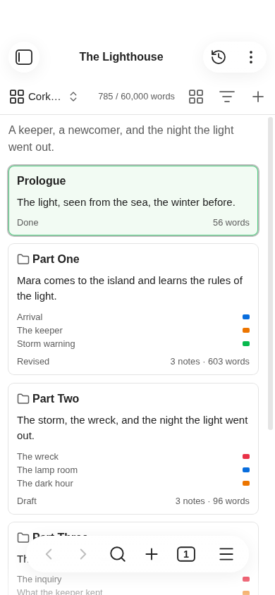

# Phones and tablets

Binders works in Obsidian on iOS and Android, with the same four modes, by touch. This page covers what touch does
differently from a mouse and a keyboard.

Phone and tablet support is new. The maintainer uses an iPhone; iPad and Android coverage is still through desktop
emulation. See [Known limitations](limitations.md#not-yet-tried). If something doesn't work as this page says,
[open an issue](https://github.com/fyresmith/binders/issues) and say which device.

## The basics

| To | Do this |
|---|---|
| Select a card or row | Tap it |
| Open a note | Tap a selected card's title |
| Edit a synopsis | Tap a selected card's or row's synopsis |
| Open the menu | Press and hold |
| Move a card or row | Press, hold and drag |
| Go into a folder | Tap its name on its card |

A selected row or folder card with no synopsis offers **Add a synopsis**. On a note's card, and in a menu, it is
**Edit synopsis**.

On a phone menus open as Obsidian's own sheets. On a tablet they open beside your finger.

**On a tablet** a card's, row's or title's menu is shorter, so that all of it fits on the screen with the tablet on
its side. Nothing is missing from it:

| On a computer or a phone | On a tablet |
|---|---|
| **Move up**, **Move down**, **Move to** | **Move**, then **Move up**, **Move down** or a folder of the binder |
| **Put in a new folder**, **New folder from selection** | **Move**, then the same words, at the foot of the list |
| **Include in export** | **Export as**, then **Leave out**. **Automatic**, or what the note is, puts it back in |

In a Longform project, which has no **Export as**, **Include in export** stays where it is.

## Selecting several

There's no Shift or Ctrl, so a card's or row's menu has **Select more**. After you choose it, each tap adds an item
to the selection or takes it out, and the menu of any of them offers **Merge 3 notes**, **New folder from selection** and
the rest. A tap on the empty board ends it.

The selection box drawn on empty space is for a mouse or a pen. A finger on empty space scrolls.

## Revision tasks

**Add revision task...** is in a card's or row's menu and in the view's **More options**. The prompt is Obsidian's own, with the field at the bottom of the screen. **Show revision tasks** opens the Revision pane as a page of the right drawer; a tap on a box ticks the task, and a tap on a scene goes there and closes the drawer. See [Revision tasks](revision-tasks.md).

## The toolbar

On a phone the toolbar's buttons are icons. **New** is a plus sign.

- **Targets:** in a pane narrower than 360 px the word count in the toolbar is its number alone. Tap it to open the
  progress window, where the target and the deadline are set. In an even narrower one it goes, and **Set word count
  target** in the command palette sets a target there. The bar and its tick for the plan to a deadline are left out in
  a pane under 440 px, as the bar is; the count's tooltip (its label, for a screen reader) still says the day's share.
- **Undo:** an **Undo** button, an arrow icon, is in the toolbar in every mode; it is dimmed when there is nothing to take back, and touching it takes back the last change. After you delete something, a notice with an **Undo** button stays for eight seconds. A phone has no room for **Redo** beside the toolbar's **Undo**: it is in the view's **More options** menu, which also says what each will do.

## Filters

**Filter** opens a sheet from the foot of the screen: tap a property, an operator and the values; **Done** shuts it. The line
under the toolbar says what is shown, with a cross to show the whole binder and **Refresh** where a note no longer matches.
See [Filters](filters.md).

## Corkboard

**Arrange by label:** on a phone the cards are small and the lines run across, their names down the left edge.
Swipe to go along the lines. Hold a card and drag it to another line to give it that label. **Arrange** is an icon
in the toolbar, and its menu a sheet.

Dragging a card out of the view, to link it in a note or drop it on a canvas, isn't available on a phone.

## Outliner

A tap on a header opens that column's menu: sort, **Move left**, **Move right**, **Hide column**. On a phone the
label column shows the color alone.

## Manuscript

The manuscript uses Obsidian's editor and its toolbar.

**On a phone,** a section is plain text to read and swipe through until you tap it. The tap puts the caret on the
letter under your finger and opens the keyboard, and the section is its editor for as long as you're in it. Tap
another section and the first goes back to plain text once what you typed is saved.

**On a tablet,** as on a computer, the sections near the screen are editors already.

**Typing:** with the keyboard up and little room left (a phone on its side), the toolbar steps aside while you type
and the manuscript runs under Obsidian's header, as a note does, so more lines are left to write in.

## Timeline

On a phone time runs down the page, in one column: each year, then each date, over its cards. There is no **Time
across** there, and no **Arrange** in the toolbar. A tablet has both, as a computer does.

- Tap a card to select it; tap its title to open its note. Hold a card for its menu, which has **Set story date...**
  and **Remove story date**: that is the main way a scene gets its date on a phone.
- Press and hold a card, then move your finger, to lift it and carry it: onto another date's cards, or onto a
  boundary between two dates (rest there a moment and the stretch unfolds into the days, months or years in it), or
  onto the **No date** row to take its date away. A tag above the card says the date it would get. A swipe still
  scrolls the page, and a touch that is cancelled writes nothing. **Shift story dates...** is in the menu when more
  than one dated scene is selected (**Select more** in the menu).
- The scenes with no date are behind the **No date** row at the foot of the page, above Obsidian's bar. Tap it to
  open the list, and again to shut it.
- The year and the date you are in stay at the top while you scroll.

See [Timeline](timeline.md).

## The inspector and the contents

The [inspector and the contents](inspector.md) are pages of the right drawer, put there when you open a binder.
Swipe in from the right edge, or run **Show inspector**.

- The inspector is on the section you last tapped.
- Your pinned properties are there too: on a phone a list goes under its name, as wide as the drawer; on a tablet it
  stays beside it. A tap on a link in one is Obsidian's, not the pane beside the writing.
- A tap on a row of the contents closes the drawer on a phone and takes the manuscript there.

## The file explorer

On a phone a tap on a binder opens it, and a tap on a folder inside it folds or unfolds it.

## Focus mode

On a phone Obsidian's bar of buttons and the note's header go. The way out is at the top, under the clock, with the
place and the word counts beside it if they're on. It goes while you type and comes back when you touch the page.
The keyboard's own toolbar stays. Press and hold the leave button for the menu.

**Enter fullscreen** isn't offered on phones and tablets.

## Paragraphs

A phone has no Tab key. Turn on **Indent paragraphs** in settings for an indented page. To start a paragraph with a
tab of your own, use the command **Start a paragraph with a tab**: add it to the toolbar over the keyboard in
Obsidian's settings, under **Toolbar**, where its button is a paragraph mark (¶). Obsidian's own indent
button there puts a tab at the start of the line too (and another each time it is tapped), and four spaces do the
same as a tab. See [Paragraphs](paragraphs.md).

## Export

- The Export window shows the choices first. **Preview** shows what will be made, and the arrow goes back to the
  choices.
- The exported file goes into the `Exports` folder in your vault, and then to the share sheet.
- A Scrivener project is zipped. Unzip it where Scrivener is.
- A PDF (a paperback, or a manuscript as a PDF) is made on a computer. On a phone or tablet you can look at its
  pages and choose its style and page, and there is no **Export**.
- **Edit this style** opens the style editor in place of the choices. On a phone, **Preview** shows the book in it.
- **Export again** is in the binder view's **More options** menu once the binder has been exported.

## Import

**Import a manuscript...** takes a Word (`.docx`), Markdown or text file through the device's file chooser. **Choose
from this vault...** also lists notes outside binders and Word files already in the vault. The choices come first;
**Preview** shows the proposed binder before you import. See [Import a manuscript](import-manuscript.md).

**Import from Scrivener...** takes a zipped backup of a project on a phone or tablet. See
[Import from Scrivener](import-scrivener.md).

## Progress

- **Show progress** is in the binder view's **More options** menu. The window is one column: the numbers two to a
  row, the calendar in half years, and each part's row without the month it grew most in. See [Progress](progress.md#on-a-phone).

## Snapshots

After **Rewrite...** from a blank page, the old text is under **Snapshots** instead of opening beside the note.

## Sizes

Buttons, cards and rows are 44 px tall or more. Folders deep in a binder indent by a narrower step, so their names
stay readable.

Next: [How your files look](files.md)
