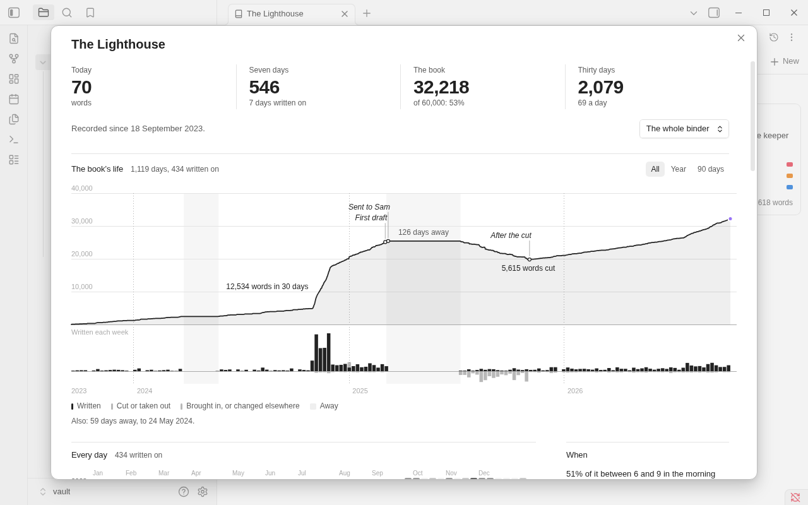
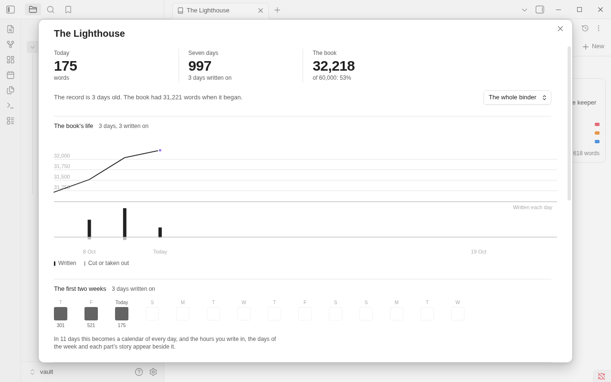

# Progress

Binders keeps a record of each binder's writing, and **Show progress** shows it: how the book has grown, the days
you wrote, when in the day and the week, when each part was written, and a page of records. This page is about the
window first, and then about the record under it: what is kept, where, and what never is.

## Opening it

**Show progress** is a command, and an item in the binder view's **More options** menu. It opens over the binder you
are in, and Esc closes it. It only reads: opening it changes no note and writes nothing to the record.

At the top right, **The whole binder** can be changed to one of the binder's folders, and the page is then that
folder's.

## What it shows

- **The numbers at the head.** What you have written **today** (added less cut), in the last **seven days**, the
  **book**'s words (against its target, if it has one) and, once there is a month to count, the last **thirty days**.
- **The book's life.** Its words over time as a line, and under it, on the same days, what was written (up) and cut
  (down). What happened is said where it happened: your best thirty days, a time away, the deepest cut, and the names
  you gave your snapshots and exports. **All**, **Year** and **90 days** choose how much of it shows. Move the pointer
  over the chart to read a day. Anything there was no room to say on the chart is said under it.
- **Every day.** A square for each day of the record, darker the more you wrote, and an outline for a day that ended
  with fewer words than it began: a day of cutting is a day of work, and is not shown as a bad one.
- **When.** The hours you add words in, and the days of the week. The days of the week are left out when no day
  stands out from the others.
- **The parts.** For each folder at the top of the binder (or each scene, in a binder with no folders), a square a
  month: when it was written. The first sixteen are listed; **Show all** lists the rest.
- **Through the statuses.** The book's words by the status of their scene, over time: a draft becoming a revision.
- **Records and oddities.** The longest day, the best month, the longest time away and the day you came back, the
  scene you came back to most, how much you cut, and what the text says of itself (how long it takes to read, its
  longest scene and sentence, how much of it is inside quotation marks).

A part of the page with nothing to say is left out. No streaks, no badges, and nothing here ever reminds you to write.

## The first days

A record starts on the day you first type in a binder with this version of Binders, so at first there is little to
show, and the window says so plainly:

- On **day one** there are the numbers, the book's life with one day on it, **The first two weeks** as fourteen
  squares with one filled, and what the text says of itself.
- The squares fill as you write. A sentence under them says in how many days they become the calendar, and what
  appears with it.
- After **two weeks** the calendar, the hours and the parts appear, and the days of the week after four.
- If the book was there before the record, the window says how many words it had when the record began, and the
  chart starts from there, not from nothing. Nothing is said about how such a book began or how many words it took.

A binder nothing has been typed in yet has no record, and **Show progress** says so in a small dialog. So does a
binder when recording is off, with a button to the setting.

## How the words are counted

- **Written** and **cut** are what you type. A single change of more than fifty words (a paste, a cut, a scene
  deleted, an import) is **brought in** or **taken out**: it moves the book's total and is not a day's writing.
- The **book's words** on a day are the total Binders counted that day. If the total moved by words nobody typed in
  Obsidian with Binders (an edit in another program, a device without Binders), the window shows them as **changed
  elsewhere**.
- **Time typing** is the minutes in which something was typed, not the time the note was open. A **sitting** runs
  from its first minute to its last, and ends after thirty minutes without typing.
- A **day** ends at four in the morning.
- With two devices, each one's writing is added to the other's. See [Sync](#sync) for what that needs.

## On a phone

The same page in one column: the numbers two to a row, the calendar in half years so a day's square can be seen, and
the parts without their last column. **Show progress** is in the view's **More options** menu.

## For a screen reader, and by keyboard

Every chart is named for what it shows and has a table of the same numbers behind it. Tab reaches the folders'
dropdown, the three ranges and **Show all**; the page itself takes the focus, so the arrow keys scroll it.

## The record

What Binders keeps, to show all of the above.

## What is kept

For each day you write, on each device:

- the words you **added** and **cut** by typing, in each note;
- the words that **came or went a block at a time** in each note: a single change of more than 50 words, such as a
  paste, a cut, a chapter deleted or an import. These move the book's total but are not counted as writing, so moving
  a scene by cutting and pasting nets to nothing, and deleting a chapter is not a day of minus four thousand;
- the words you added in each hour, and your **sittings** (a sitting ends after thirty minutes without typing);
- the binder's **total** at the end of the day, its number of scenes, and its words in each status.

And, with the time it happened, **what you did to the binder**: a note made, deleted, renamed or moved; a status or
label changed, from and to; a word count target set; the order changed; a snapshot taken (with its name) or brought
back; an export made (with its kind); an import; a split, a merge, a copy; a Replace all.

Import, split, merge, copy, Replace all and bringing back a snapshot are Binders' own acts. Each is recorded, and none
of them counts as writing.

A **day ends at four in the morning**, local time. Writing at half past midnight is still the day that is ending.
Focus mode's *words written today* use the same rule and the same record, so they are the same on every device.

## What is never kept

Any text of your notes; the keys you press, or how fast; the time you spend without typing; edits to a synopsis;
anything outside a binder; or any name of your device beyond the one you gave it (**This device is called**, in
settings).

Nothing in the record is ever written into a note, and nothing in it is sent anywhere. Binders deletes none of it.

## Where it is

In the binder's `Snapshots` folder, in `History`: one plain-text file for each device and year, such as
`Snapshots/History/2026 MacBook a1b2c3.binder-history`, one JSON object to a line. A device writes only its own file, so
two devices never overwrite each other's days. You can open one in any text editor; the format is in
[the binder format](dev/file-format.md#the-record-of-a-binders-writing-binders-history-1). It is a part of the
`Snapshots` folder, so it is not in the file explorer, the binder's contents, search or an export.

About 100 KB a year for a device that writes most days. It is written every few minutes while you write, when you
leave the binder, when the app goes to the background, and when Obsidian closes. A Longform project's record is in its
scene folder's `Snapshots` folder.

## Sync

With Obsidian Sync, a `.binder-history` file is carried only if **Sync all other types** is on (under Sync's settings,
**Selective sync**): the same as for snapshots. With it off, each device keeps its own record and the devices' days
are not added together. iCloud, Dropbox, Syncthing and git carry the files as they are.

## Stopping it, and deleting it

**Settings, Binders, Progress, Keep a record of your writing** turns recording off. Turning it off deletes nothing.
To delete a record, delete the files in `Snapshots/History` yourself (or the folder): Binders starts a new one the next
time you write, if recording is on.

## Good to know

- Only typing in Obsidian is counted as writing. An edit made in another program, or on a device without Binders,
  shows later as *changed elsewhere*: the difference between the book's totals and what was typed.
- A binder in a newer format than your Binders understands, or one that can't be changed, is not recorded.
- If a file can't be written (a full disk, a locked file), your typing is not affected; it is tried again.
