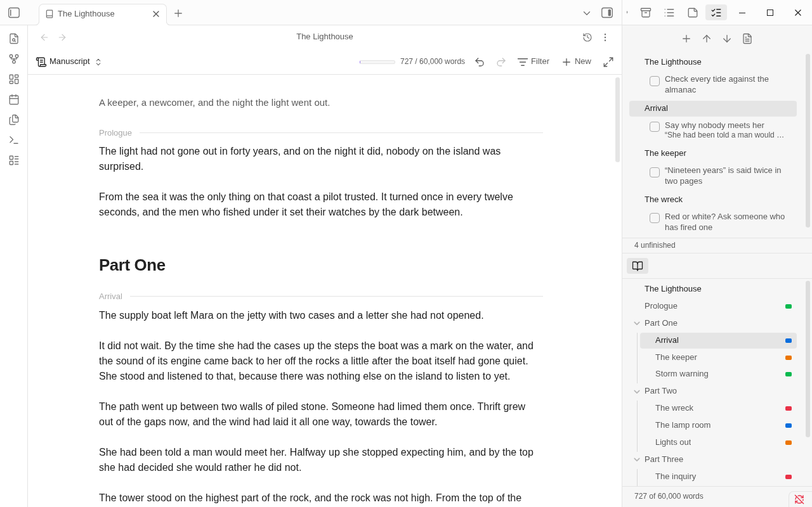
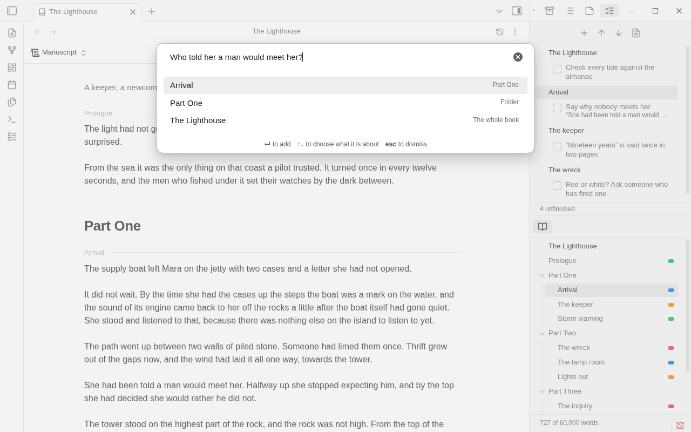

# Revision tasks

A revision task is something you want to fix in a scene, such as "establish why Alice leaves". You note it while you
are drafting, without stopping, and later work through the unfinished ones in the order of the book, ticking each off.

Tasks are kept as ordinary checkboxes with a link to the scene, in one ordinary note in the binder. There is no
scheduler, no assignment and no reminder: a task is a line of text with a box.



## Adding a task

Run **Add revision task** from the command palette. It has no default key: bind one under **Settings → Hotkeys**
if you will use it a lot. It is also in the binder view's **More options** and in the menu of a card or row
(**More › Add revision task...**).

A prompt opens with one field. Type the task. Under it is what the task is about:

- the scene you are in, first, so that **Enter** is all it takes;
- then the folders it is in;
- and the whole book, for a task that is about no scene in particular.

Use the arrow keys to choose another. If you had words selected in the scene, they are shown under the scene's name and
kept with the task as its quoted passage.



Adding a task changes nothing in the scene. What you were typing, your cursor, your selection and the scroll position
stay where they are, and when the prompt closes the keyboard is back in the page. It works the same in the
manuscript, in a note's own tab and in focus mode.

With several notes selected on a board or in the outliner, **More › Add revision task...** is one task about all of them. It
is listed under each and counted once. On a folder it is about the folder, through its folder note.

A binder in a newer format than this Binders knows, and a [Longform](longform.md) project, take no tasks, and say so.
(A Longform project made a binder with **Convert to binder** does.)

## The note

The first task makes a note called **Revision** in the binder's folder, and writes a `revision` property in the binder
note that names it. The note is a plain list, newest last:

```
- [x] [[The keeper]]: “Nineteen years” is said twice in two pages. Keep the secretary’s
- [ ] [[The wreck]]: Red or white? Ask someone who has fired one
	> The flare went up at ten past two, red, and hung over the Skerry longer than it should have.
- [ ] [[Lights out]], [[What the mate saw]]: Eleven minutes of dark or twelve? Pick one and hold to it
- [ ] Check every tide and sunset against the almanac for June 1911
```

Each task carries the link to its scene, so the scene's own **Backlinks** pane lists its tasks, and Obsidian keeps the
links right when a scene is renamed. A task with no link is about the book. The quoted passage is only text: it
does not follow edits to the scene.

- **It is not a scene.** It is not in the binder's order, the corkboard, the outliner, the manuscript, the word counts,
  find and replace, the timeline, a snapshot of the binder or an export, and typing in it is not counted in your
  [progress](progress.md). In the file explorer it is after the last scene.
- **It is yours.** Rename it, move it, edit it, sort it, delete lines, tick boxes in Obsidian's own way: Binders reads
  it again whenever it changes, however it changed. The `revision` link follows a rename or a move. To keep your tasks in
  a note you already have, point `revision` in the binder note at it.
- **It works without Binders.** It is Markdown checkboxes and links. With Binders turned off, Obsidian ticks them as
  it ticks any.
- **Your own layout is read too.** A task with no link of its own takes the link of the bullet it is under, then of the
  heading it is under, so you can keep a heading for each scene if you prefer.
- **A device with an older Binders** that has not been updated yet shows `Revision` as a last scene of the binder, and
  exports it, until it is updated. Nothing is lost; update Binders there.

## The Revision pane

**Show revision tasks** opens the pane in a sidebar, as the inspector and the contents are. It is not opened for you.
It lists the unfinished tasks under the scene each is about, in the order of the book. A task about the whole book
comes first. A task about two scenes is under both. The scene you are in is marked, as in the contents.

- Tick a box to mark the task done. Done tasks are folded away; **Show 3 done** at the foot brings them back, and
  unticks one if you change your mind. A task you just ticked stays in sight, struck through, until you move to
  another scene.
- Click a task or a scene to go there, in the mode the binder view is in: the manuscript scrolls to it, the corkboard
  opens its folder and selects its card, the outliner shows its row. With no binder view open the note opens.
- A task whose link names no note is listed last, marked **Not found**. A link to a note outside the binder is marked
  **Not in this binder**. The task is still in the revision note.
- The buttons at the top add a task, go to the previous and next, and open the revision note. The count of unfinished
  tasks is at the foot.

On a phone the pane is a page of the sidebar drawer; tapping a scene closes the drawer.

## Working through them

**Go to next revision task** and **Go to previous revision task** step through the unfinished tasks in the order of
the book, from the task you are on, or from the scene you are in. A task about two scenes is visited at each. With the
pane out of sight the task is said in a notice ("7 of 10"); with it open, its row is marked. **Mark revision task
done** ticks the one you are on. **Open revision note** opens the note.

## What Binders writes

Binders writes two things to the revision note and nothing else: one list item added at its end (with the quoted
passage under it), and the one character between a task's brackets when you tick it. It never moves, sorts or rewords a
line. If the line is no longer what it read, because you or another device changed it, nothing is written and it says so.

Any character but a space between the brackets counts as done, as in Obsidian. Binders writes `x`.

## Undo

Adding a task and ticking one are each a step in the binder's [undo history](undo.md).

- Undoing a tick puts the box back, and redo ticks it again. It is refused, with a notice, if the line has changed
  since.
- Undoing an added task takes away that item and its quoted passage, only if they are still the last lines of the note
  and exactly as they were written. If you have written under them, or changed them, nothing is removed and a notice
  says so. Redo adds the task again at the end.
- Undoing the very first task leaves the note, empty, and the `revision` property as they are: nothing is deleted.

Ctrl+Z in the editor after adding a task undoes your typing, not the task: the keyboard is back in the page. Use
**Undo last change** (or Ctrl+Z with the keyboard in the Revision pane).

## How tasks differ from a scene's notes

A scene's [notes](scene-notes.md) are free text about one scene, kept in that scene and seen one scene at a time. Tasks
are items with a done state, kept in one place for the whole book, and visited in order.

## Commands

| Command | What it does |
|---|---|
| **Add revision task** | Opens the prompt |
| **Show revision tasks** | Opens the Revision pane |
| **Go to next revision task**, **Go to previous revision task** | Walk the unfinished tasks in the order of the book |
| **Mark revision task done** | Ticks the task you are on |
| **Open revision note** | Opens the binder's revision note |
