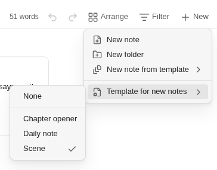

# Templates

A template is a place to start from. Binders has two kinds:

- **binder templates**: a whole binder to begin a new one from (its folders, notes, synopses and targets);
- **templates for new notes**: a note whose text and properties each new note in a folder starts with.

Both are plain files in the templates folder that Obsidian's own **Templates** core plugin uses (**Settings →
Templates → Template folder location**). If that plugin is off, Templater's templates folder is used instead.
Without a templates folder you still get Binders' two binder templates, and New binder works as before.

No story structure is required. A template only gives you a starting point, and everything it makes is yours to change.

## New binder

**New binder** (in the file explorer's menu, or the command palette) asks what the binder starts from, in Obsidian's
own prompt:

- **Empty binder** is first, so **Enter** makes an empty binder, as before;
- **Chapters and scenes**: three chapters of two scenes each, with nothing written;
- **Three acts**: three acts and eight scenes, each with a one-line prompt as its synopsis ("What happens that can’t
  be ignored."), to type over on the corkboard or in the outliner. No note has text;
- then your own binder templates, by name, each with the folder it is kept in at the end of its row.

Type to narrow the list. The binder is made at once, as "Untitled binder", with its name ready to type in the file
explorer. If the file explorer isn't in sight, the binder opens instead.

On a computer or a tablet, a notice says the binder was made and has an **Undo** button. Undo also appears in the new
binder's toolbar. It takes the whole binder to the trash, but only while every file in it is still exactly as it was
made. Once you have written in it, it stays.

## Your own binder templates

A binder template is an ordinary binder kept in the templates folder. You open, change, rename and delete it like any
other binder, and share it as a folder. A Longform project kept there works too, and is copied as a Longform project.

To make one from a binder you have, choose **Save as binder template...** in the binder's menu in the file explorer,
or in the binder view's **More options** on a computer or tablet. Give it a name. It is saved as a copy in the
templates folder:

- its folders and notes, in their order, with every property as written: synopses, labels, statuses, targets, story
  dates, and in the binder note your pinned properties, saved filters and book details;
- its binder note and folder notes, whole;
- not its snapshots or the record of your writing;
- not the notes' text, unless you tick **Keep the notes’ text**.

The binder itself is not changed.

A new binder made from your template is a copy of it, file for file, so property types (numbers, lists, dates,
checkboxes) are kept. The template stays as it was.

A binder template made by a newer version of Binders is listed with "Made by a newer version of Binders". It can't be
made into a binder until you update Binders.

## Templates for new notes

Any note in the templates folder can be a template for new notes, including the ones you already use with Obsidian's
**Insert template**. The notes inside a binder template are not offered here: they belong to that binder.

The binder view's **New** button has two more rows once your templates folder has a note in it:

- **New note from template**: makes one note from the template you pick, where **New note** would put it;
- **Template for new notes**: the template this folder's new notes start from. The one in use is ticked.

With a template chosen, **New note**, **New scene here** and **New note after this** start each note from it. Notes
made by splitting, merging, duplicating or importing don't use it, and neither do notes made with Obsidian's own **New
note** in the file explorer.

A folder that hasn't chosen a template uses the nearest folder above it that has one. **Same as “Part One”** says
which. If you choose a template for the binder, its whole book uses it. Choosing **None** in a subfolder stops it
there.

The choice is kept in the folder's note as a link (`template: "[[Scene]]"`; the binder's is in the binder note).
**Undo** takes a choice back, and you can also edit the property by hand.

### What a new note gets

- the template's properties exactly as written, so their types are kept;
- its text, with `{{title}}`, `{{date}}` and `{{time}}` (and a format, `{{date:dddd D MMMM}}`) filled in as Obsidian's
  Templates plugin fills them, with the date and time formats from its settings. `{{title}}` is filled with the name
  you type for the note;
- Binders' own `binder` and `contents` properties, if a template has them, are left out, so the new note stays a scene.

**Undo** right after takes the note away, name and all, as for any new note. Once you have written in it, it stays.

### Templater

Binders never runs Templater's code. Templater commands (`<% … %>`) are copied into the new note exactly as written.

- With Templater's **Trigger Templater on new file creation** on, Templater fills them a moment later, as it does for
  any new file. What Templater writes then counts as part of making the note, so **Undo** still takes it away.
- With it off, the commands stay in the note as text. Run Templater's **Replace templates in the active file** if you
  want them filled.
- In a folder with no Binders template, a new note starts empty, so a folder template you set in Templater applies as
  usual.

## See also

- [The binder view](binder-view.md): the New button and More options
- [Undo and redo](undo.md)
- [The binder format](dev/file-format.md): the `template` property
