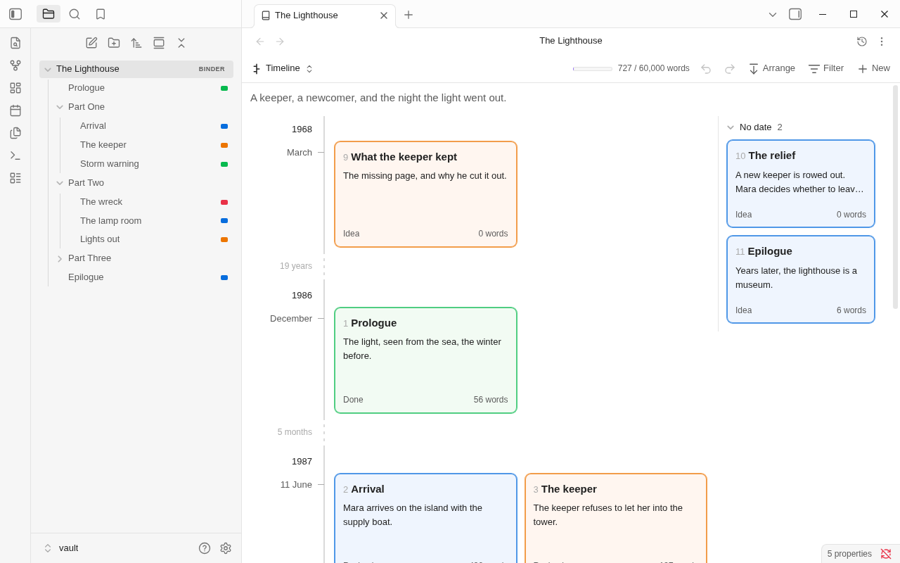
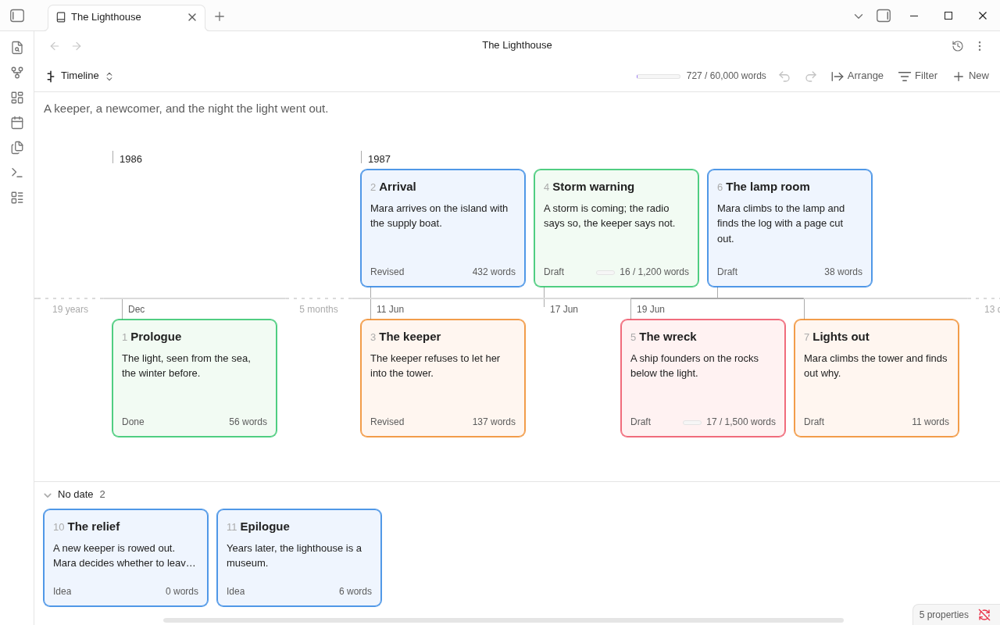

# Timeline

The timeline shows the scenes of a binder, or of one of its folders, in the order they happen in the story. A scene
stands at its [story date](story-date.md); the scenes that have none wait in a tray. Every card carries its number in
the manuscript, so you can read story time against the order of telling: a flashback told late stands first on the
line with a high number on it.

Choose **Timeline** from the button at the top left of the binder view, or run **Show timeline**.

## Reading it

- **The cards** are the corkboard's: title, synopsis, status, word count, and the label as the card's color. The
  number before a title is the note's place in the manuscript, counted through the folder shown and the folders in
  it. The numbers are always on here.
- **The line** is not to scale. Each date gets the room its scenes need, so a week of daily scenes and a jump of ten
  years take about the same space.
- **Each year** has a heading, and stays in sight while you scroll through its dates. A date under it says its day
  and month. A scene dated only to a month stands at that month, before any day in it; one dated only to a year reads
  "In 1925".
- **A gap** is a stretch drawn short: the line breaks, and says how long it was ("5 months", "10 years"). A stretch
  is drawn as a gap when it is long beside the stretches around it, so the quiet years of a book are not a row of
  gaps, but the jump into them is one.
- **Scenes on one day** stand together, ordered by a time if you wrote one, then by `story-order`, then as the
  manuscript has them. See [Story date](story-date.md#how-it-is-written).
- **The tray**, headed **No date** with a count, holds the scenes with no story date, and those whose date isn't a
  date ("sometime in spring"), in the manuscript's order. Click its heading to fold it away. While no scene has a
  date, the tray is the whole page.

The timeline shows scenes only. A folder's own story date doesn't make a card.

## Time down, or across

**Arrange** in the toolbar chooses which way time runs. The same two choices are in the menu you get by right-clicking the
board's empty ground (they are not in **More options**).

- **Time down** is how it opens: each date is a row, its name beside the line and its cards beside that, as many to a
  row as fit. The tray is down the right side.
- **Time across** puts a card above or below the line at each date, the dates on the line and the years over the
  cards. A date with several scenes takes more of the line. The tray is along the foot. With nowhere to scroll down,
  the mouse wheel moves along the line.

The choice is kept with the view. A pane narrower than 520 px, and a phone, has time down only.

## Giving a scene a date

Right-click a card and choose **More › Set story date...**, then type the date the way you would say it: `14 June 1987`,
`June 1987`, `1987`. With several cards selected, all of them get it. **More › Remove story date** sends a card back to the
tray. Each is one step for **Undo** in the toolbar. The outliner's **Story date** column and the inspector's row do
the same; see [Story date](story-date.md#setting-one).

You can also drag a card; see below.

Looking at the timeline changes nothing: opening it, scrolling, filtering and switching its shape write to no note.

## Dragging

Drag a card to give it another story date. A drag changes the story date and nothing else: never the card's place in
the manuscript, its folder or its label, and its number stays. The whole drag is one step for **Undo**.

- **Onto another date's cards.** The card takes that date, as exactly as that date says it: a day, a month or a year.
  A tag by the card says the date and where the card will stand in it ("17 June 1987, 1 of 2"). Cards that come from
  another date stand in the day where its order puts them, as the manuscript has them, and nothing else is written.
- **Between two dates.** Rest the card on the boundary between two rows, or on a gap drawn short, and the stretch
  unfolds into a place to drop for each date in it: the missing days for a gap of days, the months for a gap of
  months, the years for a gap of years. A drop on `1931` writes `1931`; on `March 1987`, `1987-03`. A very long gap
  offers every tenth year, then every hundredth, and at most sixty places; any other year is one **Set story date...**
  away. The stretch folds again when the card leaves it.
- **Before the first date or after the last.** A dialog opens, **Story date**, with the nearest date in it: change
  it, or cancel. Nothing is written until you answer.
- **The tray.** A card from the tray dropped on the line gets that date; a card dropped on the tray (it shows while a
  card is carried, even when empty) loses its date and its place in a day.
- **Several cards** carried together all take the date dropped on. To move a run of scenes and keep the space
  between them, use **Shift story dates...** (below).
- **Within a day.** Drop a card among the cards of its own day to put it in another place: the day's scenes are
  numbered 1, 2, 3 in the order you left them, in `story-order`, as one step; only the numbers that change are
  written, and nothing else is touched. A scene with a typed time (`1987-06-14T21:30`) stands by it, after the day's
  untimed scenes, and its time is never rewritten: if a card can't stand where you hold it because of its own time or a
  neighbour's, the tag says "(its time keeps it there)". A card that moves to another day keeps its time of day when
  the new date is a day, and loses it on a month or a year (it can't hold one).
- **Escape**, letting go outside the pane, on the boundary before it has unfolded, or on nothing writes nothing.
- A card carried out of the view over the file explorer, a tab or another note is a file there, as on the other
  boards.

On a phone or tablet, press and hold a card to lift it; the tag is carried above your finger. A swipe still scrolls.
**More › Set story date...** in the card's menu remains the main road on a phone.

### The keys

With a card focused, **Alt+Left** and **Alt+Right** take it (and the cards selected with it) to the date before or
after, stepping through the days, months or years of a gap as well as the dates that have scenes. **Alt+Up** and
**Alt+Down** put it one place earlier or later among its day's cards. Each is one step.

### Shift story dates

Select more than one scene, right-click, and choose **More › Shift story dates...** (the item is in the menu of every board
when more than one selected note has a date). Choose Later or Earlier, a number, and Days, Months or Years. All the
selected dated scenes move by that much, keeping the space between them, as one step. A typed time goes along. A
scene dated only to a month moves by months or years, one dated only to a year by years: a date that can't be moved by
what you chose stays as it is, and a notice says how many. A day that the new month hasn't got (31 January, a month
on) becomes its last. Scenes with no date are left alone, and a scene's `story-order` goes with it.

## Selecting and opening

As on the corkboard:

- Click a card to select it. Ctrl-click (Cmd-click on macOS) adds or removes one, and Shift-click selects from the
  last card clicked to this one, through story order. Drag across empty ground to select with a box.
- Double-click a card, or press Enter, to open its note. Ctrl+Enter opens it in a new tab.
- Click a selected card's synopsis to edit it in place; F2 renames the note.
- The arrow keys move through the scenes: Left and Right to the one before or after in story time, Up and Down to the
  nearest card that way. Home and End go to the first and last. Shift with an arrow extends the selection.
- The [inspector](inspector.md) shows the card you're on.

**New** in the toolbar makes a note at the end of the folder shown. It has no date, so it appears in the tray.

**Filter** works here as in the other modes ([Filters](filters.md)): only the scenes that match are shown, and the
numbers are the scenes' places in the book, as without a filter. [Find](find-and-replace.md) lights the cards whose notes have a match.

**Cards** (the size, and **Tint cards with their label color**), in **More options**, are the corkboard's own settings and
are shared with it. A card here is one height at each size, so a long synopsis ends in an ellipsis.

## A book's own calendar and eras

A book can have a calendar of its own: months of any names and lengths, leap days, and eras. Choose **Calendar...** in
**More options** on the timeline, or run **Edit calendar...**. See [Story date](story-date.md#a-books-own-calendar) for
how dates are typed and written in it.

- **Eras** are headings over their years. An era's name stays at the top of the pane while its years scroll, as a
  year's does over its dates, and the years under it say the era's year: "The Age of Lamps", then "802", then "14
  Frost". With time across, the eras are a strip over the years. Everywhere else a date says its era: "14 Frost 802
  AL".
- **Gaps** are said in the book's months and years ("4 months", "841 years"), and a gap unfolds into the book's own
  days, months or years when a card is carried over it. A month of one day, a festival, reads as its name alone:
  "Midsummer".
- If the binder note's calendar can't be read, the timeline says so over the board, and no story date can be set in
  the book until it is put right: it would be written in a calendar the book doesn't mean.

## Limits

- Weekdays aren't shown, in either calendar.
- The timeline has no zoom: it is always as long as its cards need.
- In a [Longform project](longform.md) it shows the project's scenes, each read from its own note.
- On a phone or tablet, see [Phones and tablets](mobile.md#timeline).

Next: [The inspector and the contents](inspector.md)
